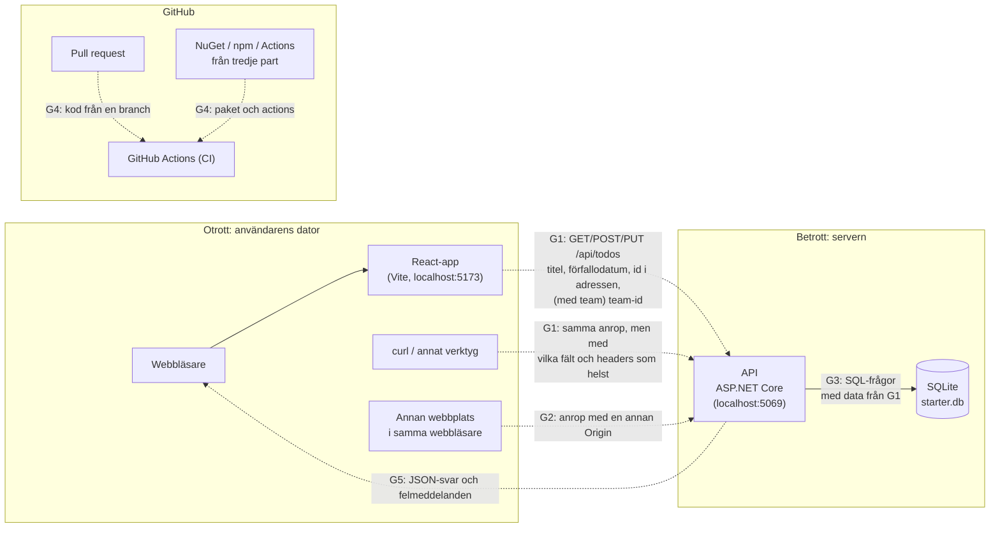

# Hotmodell: fyra team i samma app

> **Bakgrund.** Sara skriver: "Tre andra team på företaget vill också börja använda appen. Men ett krav:
> inget team får se eller ändra ett annat teams uppgifter. Ekonomi har saker där som ingen annan får läsa."
>
> Från och med nu använder fyra team samma API och samma databas. Varje ny användare är också en möjlig
> angripare: nyfiken, missnöjd eller bara slarvig.
>
> **Om källorna.** Systembilden bygger på koden i det här repot. Hoten togs fram med hjälp av AI och är
> granskade mot vår egen app. Det som gäller appen *när team har lagts till* är märkt **(med team)**.

## 1. Vad vi skyddar, och varför det är värdefullt

| Tillgång | Vad som händer om den skadas |
|---|---|
| **Ekonomiteamets uppgifter** (konfidentialitet) | Uppgifterna kan avslöja löner, uppsägningar, affärer eller kunders betalningsproblem. En läcka kan bryta mot GDPR, skada förtroendet för ekonomi och leda till att ingen vågar lägga in känsliga saker i appen. |
| **Alla teams uppgifter** (integritet) | Om någon kan ändra, flytta, bocka av eller ta bort ett annat teams uppgifter missas deadlines igen, och den här gången utan att någon märker det. Det var precis det Sara ville bort ifrån. |
| **Statistiken** (integritet) | Saras mätvärde, andelen uppgifter som blir klara i tid, blir värdelöst om uppgifter kan bockas av eller ändras av någon annan. |
| **Tillgänglighet på morgonen** | Alla team öppnar listan vid samma tid. Om API:t är nere eller segt då, slutar folk använda den, och vi är tillbaka där vi började. |
| **Koden och byggkedjan** | Den som kan få in kod via en PR, ett beroende eller en GitHub Action kan göra allt ovan på en gång. |

## 2. Systemet och förtroendegränserna

Allt till vänster om en streckad pil kommer från något vi **inte** litar på. Den viktigaste gränsen går mellan
webbläsaren och API:t: där kan användaren ändra varje fält, varje header och varje id i adressen, till exempel
med curl. Det spelar ingen roll vad React-appen skickar.

| Gräns | Från (otrott) | Till (betrott) | Vad som skickas |
|---|---|---|---|
| **G1** | Webbläsare, React-app, curl | API | Titel, förfallodatum, id i adressen, JSON-kropp, headers. **(med team)** vilket team användaren påstår sig tillhöra. |
| **G2** | Annan webbplats i användarens webbläsare | API | Samma anrop, men med en annan `Origin`-header. |
| **G3** | API (med data från G1) | Databas | SQL-frågor som byggs av EF Core, med värden som användaren har skickat. |
| **G4** | Pull request, beroenden, tredjeparts-actions | GitHub Actions | Kod som körs i CI, paket från NuGet och npm, actions från andra repon. |
| **G5** | API | Webbläsare | Svar och felmeddelanden. Gränsen åt andra hållet: det här ska inte avslöja mer än nödvändigt. |

## 3. Hot per gräns, sorterade efter STRIDE

### G1: Webbläsare → API (den viktigaste gränsen)

| STRIDE | Hot | Hur det skulle gå till i vår app | Läge idag |
|---|---|---|---|
| **S**poofing | En användare låtsas tillhöra ett annat team. | **(med team)** Om API:t tror på ett team-id som klienten skickar, i en header, en query-parameter eller i JSON-kroppen, räcker det att byta värdet. | Det finns ingen inloggning alls. API:t vet inte vem som anropar. |
| **T**ampering | Någon ändrar eller bockar av ett annat teams uppgift. | `PUT /api/todos/{id}/done` tar ett id i adressen. **(med team)** Om API:t inte kontrollerar att uppgiften tillhör anroparens team, räcker det att byta id. | Alla kan bocka av alla uppgifter. |
| **T**ampering | Någon skickar fält som formuläret aldrig visar. | **(med team)** Om API:t binder JSON-kroppen direkt till entiteten kan någon skicka med `teamId`, `isDone` eller `id` och flytta en uppgift till ett annat team (mass assignment). | `CreateTodoRequest` har bara `Title` och `DueDate`, så det går inte idag. Risken kommer om någon tar en genväg när team läggs till. |
| **R**epudiation | Någon ändrar eller tar bort en uppgift och nekar sedan till det. | Ingenting loggas om vem som skapade, ändrade eller bockade av en uppgift. | Ingen granskningslogg. Uppgifter har bara `CreatedAt`. |
| **I**nformation disclosure | Ett team läser ett annat teams uppgifter. | **(med team)** Listan filtreras på team, men en annan endpoint gör det inte: till exempel `/api/todos/overdue`, en framtida `/api/todos/{id}` eller `/api/todos/stats`. Det räcker att en enda endpoint glömmer filtret. | Alla ser allt. |
| **I**nformation disclosure | Någon räknar ut att en uppgift finns. | **(med team)** Om API:t svarar 403 för ett annat teams uppgift och 404 för en som inte finns, kan en angripare gissa sig fram till vilka id:n som finns. | Ej aktuellt än. |
| **D**enial of service | Någon gör appen oanvändbar för alla. | Tusentals anrop i minuten, till exempel mot sökningen eller `POST /api/todos`. Eller väldigt många uppgifter, som gör att listan, som skickas i sin helhet och sorteras i minnet, blir långsam för alla. | Ingen rate limiting. Ingen paginering. Titeln är begränsad till 200 tecken. |
| **E**levation of privilege | En vanlig användare får göra det bara en teamledare borde få. | **(med team)** Om det finns en roll som teamledare eller admin, och rollen bestäms av något klienten skickar. | Det finns inga roller än. |

### G2: Annan webbplats → API

| STRIDE | Hot | Hur det skulle gå till i vår app | Läge idag |
|---|---|---|---|
| **S**poofing / **T**ampering | En annan webbplats får användarens webbläsare att anropa API:t. | Om CORS tillåter alla origins (`AllowAnyOrigin`), kan en sida som användaren besöker läsa listan eller skapa uppgifter i användarens namn. Det blir värre när det finns inloggning med cookies. | CORS tillåter bara `Frontend:Origin` (`http://localhost:5173`). Det ska inte bli bredare. |

### G3: API → Databas

| STRIDE | Hot | Hur det skulle gå till i vår app | Läge idag |
|---|---|---|---|
| **T**ampering / **I**nformation disclosure | SQL-injektion. | Om en sökning bygger SQL genom att klistra ihop text (`"... LIKE '%" + q + "%'"`), kan någon skriva `' OR 1=1 --` och få tillbaka alla teams uppgifter, eller ändra data. | All databasåtkomst går via EF Core och LINQ, som skickar värden som parametrar. Det finns ingen sökning än. |
| **I**nformation disclosure | Databasfilen läcker. | `starter.db` är en fil på servern. Den som kommer åt filen, eller en backup, läser alla teams uppgifter på en gång. | Filen ligger i `.gitignore` och ska aldrig committas. |

### G4: Pull request och beroenden → GitHub Actions

| STRIDE | Hot | Hur det skulle gå till i vår app | Läge idag |
|---|---|---|---|
| **T**ampering | Skadlig kod kommer in via ett paket eller en action. | Ett NuGet- eller npm-paket, eller en GitHub Action från tredje part, byts ut mot en skadlig version. | `dorny/paths-filter` är låst till en exakt commit. Övriga actions är från GitHub själva. Dependabot är avstängt, så ingen bevakar sårbara paket automatiskt. |
| **E**levation of privilege | En PR får för mycket makt i CI. | En PR som ändrar workflow-filen kan försöka läsa hemligheter eller skriva till repot. | `permissions: contents: read`. Inga hemligheter i repot. `main` kräver grön "CI OK". |

### G5: API → Webbläsare (svaren)

| STRIDE | Hot | Hur det skulle gå till i vår app | Läge idag |
|---|---|---|---|
| **I**nformation disclosure | Felmeddelanden avslöjar hur systemet ser ut. | Ett oväntat fel, till exempel trasig JSON eller ett databasfel, visar en stacktrace med filsökvägar, klassnamn och SQL. | `UseExceptionHandler` och `AddProblemDetails` är på, men vad som syns beror på miljön. `launchSettings.json` kör alltid `Development`. Behöver kontrolleras. |
| **I**nformation disclosure | API:t avslöjar sin egen beskrivning. | OpenAPI-dokumentet visar alla endpoints och fält. | `MapOpenApi()` körs bara i Development. |

## 4. De fem hot som är mest troliga och skulle göra mest ont

| # | Hot | Varför troligt | Varför det gör ont |
|---|---|---|---|
| 1 | **API:t litar på det team klienten påstår** (Spoofing, G1) | Det finns ingen inloggning idag. Den enklaste lösningen för team är att låta klienten skicka sitt team-id, och det räcker att ändra det med curl. | Alla andra skydd faller. Om API:t inte vet vem som anropar spelar det ingen roll hur bra filtreringen är. |
| 2 | **Byta id och läsa ett annat teams uppgift** (Information disclosure, G1) | Trasig åtkomstkontroll är nummer ett på OWASP Top 10. Det räcker att en enda endpoint glömmer team-filtret, till exempel `/overdue`, `/stats` eller en framtida `/{id}`. Ett id är bara en siffra som går att räkna upp. | Det är precis det Sara sa inte får hända med ekonomis uppgifter. En läcka av till exempel löner eller affärer kan också bryta mot GDPR. |
| 3 | **Byta id och ändra eller bocka av ett annat teams uppgift** (Tampering, G1) | Samma brist som nummer 2, fast med `PUT`. Idag kan vem som helst bocka av vilken uppgift som helst. | Deadlines missas igen, och utan att någon märker det, eftersom uppgiften ser klar ut. Saras statistik blir dessutom fel. |
| 4 | **Skicka med fält som formuläret inte visar** (Tampering, G1) | När `TeamId` läggs till på uppgifter är det frestande att binda JSON direkt till entiteten. Då går det att skicka med `teamId` eller `isDone`. | En uppgift kan flyttas till eller från ett annat team: smugglas in hos ekonomi, eller försvinna från sitt eget team. |
| 5 | **SQL-injektion i en sökning** (Tampering och Information disclosure, G3) | Med fyra team och fler uppgifter kommer det att behövas en sökning. Om den byggs genom att klistra ihop text i stället för med LINQ och parametrar, finns hålet där. | Ett enda anrop (`' OR 1=1 --`) kan ge alla teams uppgifter på en gång, eller ändra data. |

**Varför just de här:** nummer 1–3 handlar direkt om Saras krav, *"inget team får se eller ändra ett annat
teams uppgifter"*. Det är det nya i appen, och därför både det troligaste och det som skulle göra mest ont.
Nummer 4 och 5 är klassiska misstag som lätt kommer in när nya funktioner byggs snabbt.

**Nära att komma med:**
- **Ingen loggning** (Repudiation). Utan loggning upptäcker vi aldrig om något av hoten ovan faktiskt händer.
- **Ingen rate limiting** (Denial of service). Ett överbelastat API på morgonen drabbar alla fyra team, men ett
  internt verktyg är ett ganska osannolikt mål.
